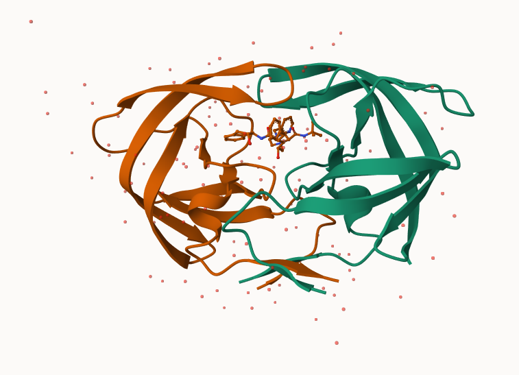
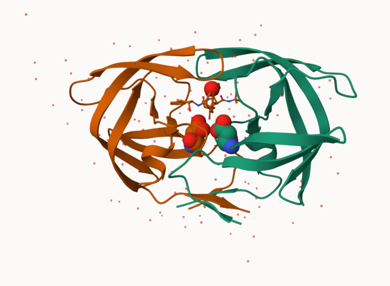
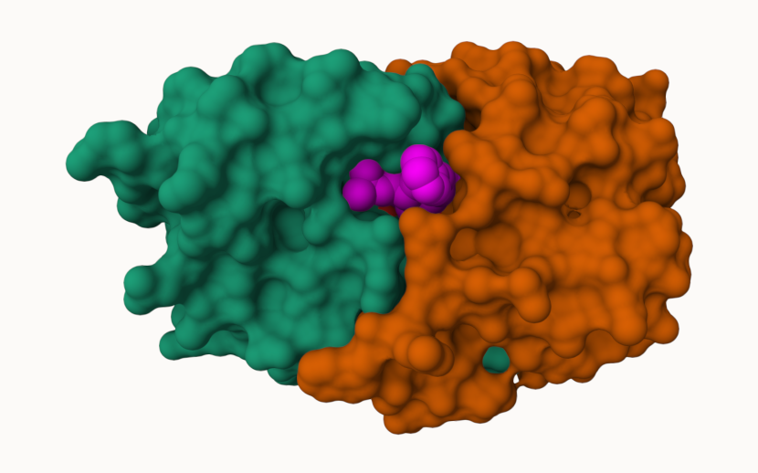

## Background

The [PDB database](https://www.rcsb.org/) is the main repository of biomolecular structure information. Let's have a look at the composition of this database:

Visit PDB and click:
Analyze > PDB Statistics > Experimental Method > Summary

We can "scrape" data from this page with the **datapasta** package that we can install from CRAN `install.packages("datapasta")`

Then "Addins > Pasta as data.frame":
```{r, echo = FALSE}
pdb <- data.frame(
  stringsAsFactors = FALSE,
       check.names = FALSE,
           Molecular.Type = c("Protein (only)",
                              "Protein/Oligosaccharide","Protein/NA",
                              "Nucleic acid (only)","Other","Oligosaccharide (only)",
                              "Total"),
              Xray = c(184731, 10716, 9341, 3216, 178, 11, 208193),
                EM = c(25754, 4037, 7520, 347, 27, 1, 37686),
               NMR = c(12904, 34, 288, 1599, 35, 6, 14866),
       Integrative = c(365L, 8L, 27L, 3L, 4L, 0L, 407L),
  Multiple.methods = c(232L, 11L, 8L, 15L, 0L, 1L, 267L),
           Neutron = c(86L, 1L, 0L, 3L, 0L, 0L, 90L),
             Other = c(32L, 0L, 0L, 1L, 0L, 4L, 37L),
             Total = c(224104, 14807, 17184, 5184, 244, 23, 261546)
       )
```

```{r}
pdb
```

> **Q1:** What percentage of structures in the PDB are solved by X-Ray and Electron Microscopy.

The percent of structures in PDB that are solved by X-ray is 79.6% and in Electron Microscopy is 14.4%
```{r}
sum(pdb$Xray) / sum(pdb$Total) * 100
sum(pdb$EM) / sum(pdb$Total) * 100
```


> **Q2:** What proportion of structures in the PDB are protein?

The proportion of structures in PDB that are protein is approximately 0.86 or 86%
```{r}
library(dplyr)

pdb %>%
  summarize(Protein_Proportion = Total[Molecular.Type == "Protein (only)"] / Total[Molecular.Type == "Total"])

```


> **Q3:** Type HIV in the PDB website search box on the home page and determine how many HIV-1 protease structures are in the current PDB?

1,198 structures were found when searching up "HIV-1 protease" in the PDB website

## The Mol-star viewer

This viewer is embedded into many newer bioinformatics databases including the PDB and UniProt. The viewer is also accessible from it's homepage: https://molstar.org



> **Q4.** Water molecules normally have 3 atoms. Why do we see just one atom per water molecule in this structure?

The method for generating the structure is through X-rays. Water molecules have 3 atoms including 1 oxygen and 2 hydrogens. However, only oxygen is able to be seen because the 2 hydrogens have too little electron density (only one electron). This means that its signal will be too weak to detect with little scattering power. 

> **Q5.** There is a critical “conserved” water molecule in the binding site. Can you identify this water molecule? What residue number does this water molecule have

Yes, I can identify this water molecule, the water molecule is identified as HOH 308. It is near the binding pocket and the aspartates. 


HIV-Protease (or HIV-PR for short) is a critical HIV enzyme required for virus replication. It is an Aspartal protease, which means it uses Asp amino acid residues to cleave proteins.

> **Q6.** Generate and save a figure clearly showing the two distinct chains of HIV-protease along with the ligand. You might also consider showing the catalytic residues ASP 25 in each chain and the critical water (we recommend “Ball & Stick” for these side-chains). Add this figure to your Quarto document. Discussion Topic: Can you think of a way in which indinavir, or even larger ligands and substrates, could enter the binding site?

Shown below is the figures showing the distinct chains in orange and green. The ligand is visible in the center of the pocket and the catalytic residues are the spacefill spheres on the bottom. The HOH308 is the red sphere in the top of the ligand. 

Larger ligands/substrates can enter the binding site by opening of the two flexible beta flaps covering the active site. 





## Bio3D in R

The **bio3d** package is for structural bioinformatics and allows us to read structural data and perform bioinformatics analysis all within R itself. 

```{r}
library(bio3d)

hiv <- read.pdb("1hsg")
```
```{r}
hiv
```

> **Q7.** How many amino acid residues are there in this pdb object?

There are 198 amino acid residues

> **Q8.** Name one of the two non-protein residues?

There is HOH and MK1 non-protein residues

> **Q9.** How many protein chains are in this structure?

There are 2 protein chains in total of the structure


```{r}
attributes(hiv)
head(hiv$atom)
```

```{r}
pdbseq(hiv)
```

### Quick structure viz in R

We can use the new **bio3d.view** package to more easily view structures quickly in R:

```{r}
library(bio3dview)
```

```{r}
view.pdb(hiv)
```

```{r}
#Select ASP 25
asp <- atom.select(hiv, resno = 25)

view.pdb(hiv, highlight = asp, highlight.style = "spacefill")
```


## Predict the dynamics of ADK

Let's read a new PDB structure of Adenylate Kinase and perform Normal mode analysis.

```{r}
adk <- read.pdb("6s36")
m <- nma(adk)
plot(m)
```

Also make a little molecular molview (trajectory) for viewing in Mol-star

```{r}
mktrj(m, file = "adk_dynamic.pdb")
```

```{r}
view.nma(m)
```

> **Q10.** Which of the packages above is found only on BioConductor and not CRAN? 

Multiple Sequence Alignment (aka "msa")

> **Q11.** Which of the above packages is not found on BioConductor or CRAN?: 

Bio3d View

> **Q12.** True or False? Functions from the pak package can be used to install packages from GitHub and BitBucket? 

True, pak package can be used to install packages from GitHub and BitBucket using remote.

> **Q13.** How many amino acids are in this sequence, i.e. how long is this sequence?

There are 214 amino acids in total for this sequence

```{r}
hits <- NULL
hits$pdb.id <- c('1AKE_A','6S36_A','6RZE_A','3HPR_A','1E4V_A','5EJE_A','1E4Y_A','3X2S_A','6HAP_A','6HAM_A','4K46_A','3GMT_A','4PZL_A')

files <- get.pdb(hits$pdb.id, path="pdbs", split=TRUE, gzip=TRUE)
```
```{r}
# Align releated PDBs
pdbs <- pdbaln(files, fit = TRUE, exefile="msa")
```

```{r}
# Vector containing PDB database codes
ids <- basename.pdb(pdbs$id)

anno <- pdb.annotate(ids)
unique(anno$source)
```
```{r}
# Perform PCA
pc.xray <- pca(pdbs)
plot(pc.xray)
```

```{r}
# Calculate RMSD
rd <- rmsd(pdbs)

# Structure-based clustering
hc.rd <- hclust(dist(rd))
grps.rd <- cutree(hc.rd, k=3)

plot(pc.xray, 1:2, col="grey50", bg=grps.rd, pch=21, cex=1)
```

```{r}
# Visualize first principal component
pc1 <- mktrj(pc.xray, pc=1, file="pc_1.pdb")
```


```{r}
#Plotting results with ggplot2
library(ggplot2)
library(ggrepel)

df <- data.frame(PC1=pc.xray$z[,1], 
                 PC2=pc.xray$z[,2], 
                 col=as.factor(grps.rd),
                 ids=ids)

p <- ggplot(df) + 
  aes(PC1, PC2, col=col, label=ids) +
  geom_point(size=2) +
  geom_text_repel(max.overlaps = 20) +
  theme(legend.position = "none")
p
```

```{r}
# NMA of all structures
modes <- nma(pdbs)
plot(modes, pdbs, col=grps.rd)
```


> **Q14.** What do you note about this plot? Are the black and colored lines similar or different? Where do you think they differ most and why?

I notice that the black line fluctuates much less than the colored (red and green) ones, the black and colored lines are different. They differ the most around the residues 125-150 where the colored lines peak in fluctuations up to around 3.0. The colored also peaks around 50-60 where it experiences fluctuations of around 1.5. These peaks are likely related to the different chains A and B of the beta flap.

