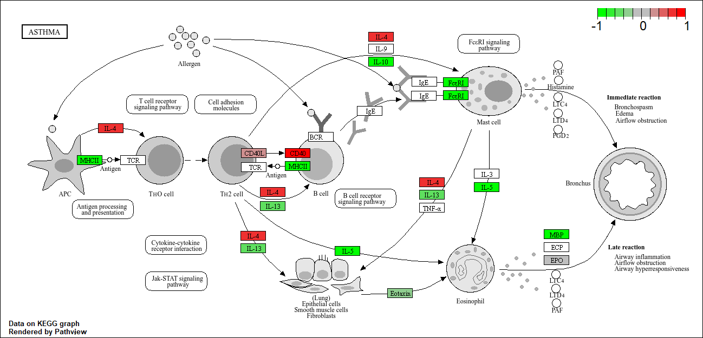

## Background

Today we will do our first RNASeq analysis fo a dataset from a study of a common synthetic glucocorticoid, called dexamethasone, on airway smooth muscle cells. 

## Data Import

There are two input CSV files to read, the first is so-called "counts" data the 2dn is metadata about the design of the experiment (i.e. the columns in "counts"):

```{r}
counts <- read.csv("airway_scaledcounts.csv", row.names=1)
metadata <- read.csv("airway_metadata.csv")
```

```{r}
head(counts)
```

```{r}
head(metadata)
```

> **Q1.** How many genes are in this dataset?

There are 38,694 genes in this dataset

```{r}
nrow(counts)
```

> **Q2.** How many 'control' cell lines do we have?

We have 4 control cell lines and 4 treated

```{r}
table(metadata$dex)
```

## Toy differential gene expression

```{r}
control <- metadata[metadata[,"dex"]=="control",]
control.counts <- counts[ ,control$id]
control.mean <- rowSums( control.counts )/4 
head(control.mean)

```
```{r}
library(dplyr)
control <- metadata %>% filter(dex=="control")
control.counts <- counts %>% select(control$id) 
control.mean <- rowSums(control.counts)/4
head(control.mean)
```

> **Q3.** How would you make the above code in either approach more robust? Is there a function that could help here?

Use ncol(control.counts)

```{r}

control <- metadata %>% filter(dex=="control")
control.counts <- counts %>% select(control$id) 
control.mean <- rowSums(control.counts)/ncol(control.counts)
head(control.mean)

```

### Our Plan

We want to compare "control" vs "treated" (i.e. no-drug vs drug experiments). We can calculate the mean count value for every gene (rows) in all 4 "control" experiments and compare it to the mean "count" value in all "treated" experiments (i.e. columns)

1. Extract all "control" columns
2. Calculate the mean of these columns
3. Do the same for "treated" to get a `treated.mean`


```{r}
#Control
control.inds <- metadata$dex == "control"
```

```{r}
control.counts <- counts[,control.inds]
dim(control.counts)
```

```{r}
control.mean <- rowMeans(control.counts)
head(control.mean)
```

> **Q4.** Follow the same procedure for the treated samples (i.e. calculate the mean per gene across drug treated samples and assign to a labeled vector called treated.mean)

```{r}
#Treated
treated.mean <- rowMeans(counts[,metadata$dex == "treated"])
head(treated.mean)
```

For easy book-keeping lets store these two mean values together in one data.frame called `mycounts`

```{r}
meancounts <- data.frame(control.mean, treated.mean)
```

> **Q5.** Make a plot with base R or ggplot2 of treated vs control mean values?

```{r}
plot(meancounts)
```
```{r}
library(ggplot2)
ggplot(meancounts) + aes(control.mean, treated.mean) + geom_point(alpha = 0.2)
```

> **Q6.** Re-draw or re-plot these on a log-log axis scale.

```{r}
plot(meancounts, log = "xy")
```

```{r}
library(ggplot2)
ggplot(meancounts) + aes(control.mean, treated.mean) + geom_point(alpha = 0.2) + scale_x_continuous(trans = "log2") + scale_y_continuous(trans = "log2")
```

We can compare the mean values of treated and control in terms of "log fold change values". Typically we use log2 units:

```{r}
# No change = 0
log2(20/20)
```

```{r}
# Up x2 = 1
log2(40/20)
```
```{r}
# Down
log2(20/40)
```

Let's add our Log2 Fold Change `log2fc` values to our `meancounts` data frame.

```{r}
meancounts$log2fc <- log2(meancounts$treated.mean / meancounts$control.mean)
```

```{r}
head(meancounts)
```

A common threshold for calling a gene "up regulated" is a log2fc value of +2. For "down regulated" it is -2. 

First filter out zero count genes - as we can't say anything about them if we don't have any count data for them

```{r}
zero.vals <- which(meancounts[,1:2]==0, arr.ind=TRUE)

to.rm <- unique(zero.vals[,1])
mycounts <- meancounts[-to.rm,]
head(mycounts)
```

> **Q7.** What is the purpose of the arr.ind argument in the which() function call above? Why would we then take the first column of the output and need to call the unique() function?

The arr.ind is used to find and remove rows containing zeros.

> Q. How many genes are "up regulated" at +2 or above?

```{r}
sum(mycounts$log2fc >= 2)
```
> **Q8.** Using the up.ind vector above can you determine how many up regulated genes we have at the greater than 2 fc level?

There are 250 up regulated genes > 2 fc level

```{r}
up.ind <- sum(mycounts$log2fc > 2)
up.ind
```
> **Q9.** Using the down.ind vector above can you determine how many down regulated genes we have at the greater than 2 fc level? 

There are 367 down regulated genes greater than 2 fc level

```{r}
down.ind <- sum(mycounts$log2fc < (-2))
down.ind
```

> **Q10.** Do you trust these results? Why or why not?

No, they do not have normalization and some lack significance values (p value not meaningful enough for significant difference)

##DESeq2 Analysis

Let's do this properly and put a P-value on these differences to keep our inner stats nerd happy!

```{r, message = FALSE}
library(DESeq2)
```

To use DESeq2 we need to have our input data (our `counts` and `metadata`) stored together in a specific format that DESeq uses.

```{r}
## Setup for DESeq
dds <- DESeqDataSetFromMatrix(countData = counts, colData = metadata, design = ~dex)
```

Now we can run the main analysis with the `DESeq()` function:

```{r}
dds <- DESeq(dds)
```

We can get our main results table from this `dds` object with the `results()` function:

```{r}
res <- results(dds)
head(res)
```

## Summary Figure

A common plot in this type of work combines log2fc values and adjusted P-values together into one figure to highlight genes to focus on that both change allot in expression values and that change is significant. Some folks call this a volcano plot.

```{r}
ggplot(res) + aes(log2FoldChange, padj) + geom_point()
```

```{r}
ggplot(res) + aes(log2FoldChange, -log(padj)) + geom_point() + geom_vline(xintercept = -2, col = "red") + geom_vline(xintercept = 2, col = "red") + geom_hline(yintercept = -log(0.005), col = "red")
```

## Save our results so far
```{r}
write.csv(res, file = "my_results.csv")
```

Add color to our volcano plot to more clearly highlight the subset of genes that we will take forward next day to further analysis

```{r}
res$color_group <- "gray"
res$color_group[abs(res$log2FoldChange) > 2] <- "blue"
res$color_group[res$padj < 0.01 & abs(res$log2FoldChange) > 2] <- "red"

ggplot(res) + 
  aes(log2FoldChange, -log(padj)) + 
  geom_point(aes(col = color_group)) + 
  geom_vline(xintercept = -2, col = "red") + 
  geom_vline(xintercept = 2, col = "red") + 
  geom_hline(yintercept = -log(0.005), col = "red")
```

## Adding Annotation

Our main results to date are in the object called `res`. It has only ENSEMBLE IDs at the moment `rownames(res)`

```{r}
head(res)
```

We will use two bioconductor packages to add gene symbols and entrez IDs to our results. These are **AnnotationDbi** and **org.Hs.eg.db**

To install these we need to use BiocManager `BiocManager::install()`
```{r}
library(AnnotationDbi)
library(org.Hs.eg.db)
```

Let's first have a peak at the different database formats we can "map" between:
```{r}
columns(org.Hs.eg.db)
```
We can use the `mapIds()` function to translate or map our "ENSEMBL" format rownames to gene "SYMBOL" etc.

```{r}
res$symbol <- mapIds(org.Hs.eg.db, 
                keys = rownames(res), # Our current IDs
                keytype = "ENSEMBL", #Their current format
                column = "SYMBOL") #The format we want!

head(res)
```

We can also add "GENENAME" and "ENTREZID", can you add these in the same way resulting in a `res$genename` and `res$entrez` columns in our main `res` results object:

```{r}
res$genename <- mapIds(org.Hs.eg.db, 
                keys = rownames(res), # Our current IDs
                keytype = "ENSEMBL", #Their current format
                column = "GENENAME") #The format we want!

res$entrez <- mapIds(org.Hs.eg.db, 
                keys = rownames(res), # Our current IDs
                keytype = "ENSEMBL", #Their current format
                column = "ENTREZID") #The format we want!

head(res)
```


## Pathway Analysis

For this analysis we need 3 more packages that I can install with `BiocManager::install( c("pathview", "gage", "gageData"))`

```{r}
library(gage)
library(gageData)
library(pathview)
```

As input gage wants a simple vector of importance (e.g. our log2 fold-change values) that has the correct gene IDs set as the `names()`. 

```{r}
foldchanges <- res$log2FoldChange
names(foldchanges) <- res$entrez
```

```{r}
#Load my gene-sets/pathways
data(kegg.sets.hs)
keggres = gage(foldchanges, gsets = kegg.sets.hs)
```

What is in our gage results?
```{r}
attributes(keggres)
```
Look at the top 3 "down regulated" KEGG pathways
```{r}
head(keggres$less, 3)
```

We can take any of these "pathways" via their KEGG hsa ID and our `foldchanges` vector and see how our genes map to the pathway.

```{r}
pathview(gene.data = foldchanges, pathway.id = "hsa05310")
```




